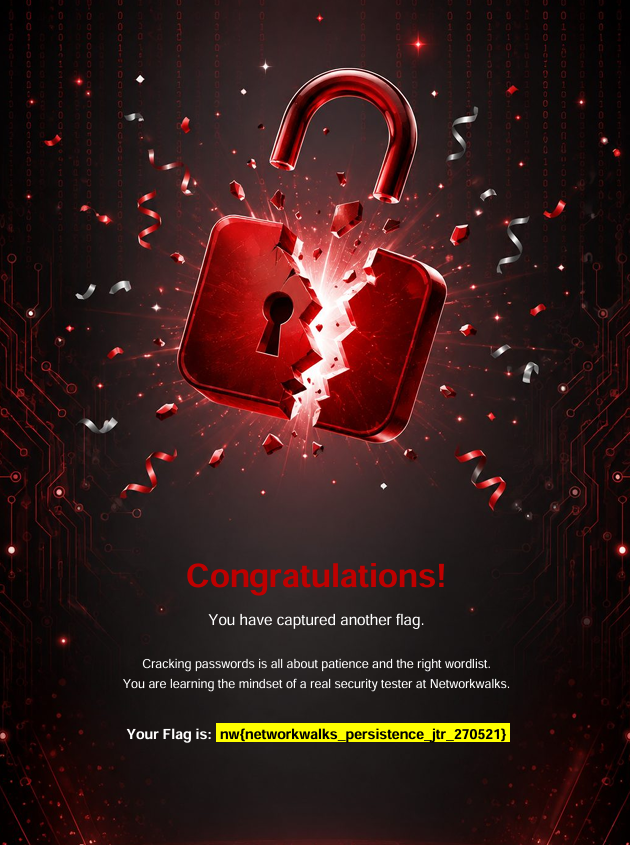
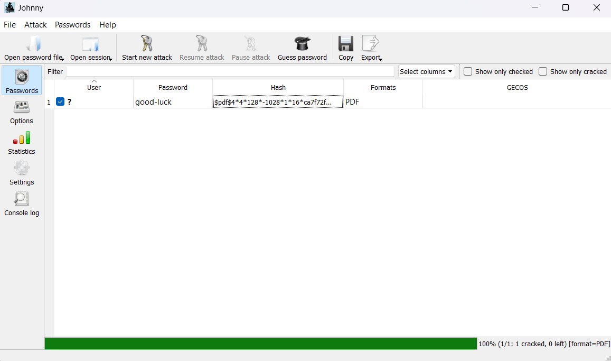

# 🔐 Networkwalks-Week3-Password-Cracking-Lab

A hands-on cybersecurity lab demonstrating password recovery on encrypted PDF files using two different approaches: an offline cracking tool (**John the Ripper + Johnny GUI**) and online cracking utilities (**Networkwalks Hash Calculator & Password Cracker**).

> ⚠️ **Educational Use Only**
> This project was completed strictly for academic/training purposes on PDF files provided as part of a lab exercise. The techniques shown here should only ever be used on files you own or have explicit permission to test. Unauthorized password cracking is illegal.

---

## 📌 Project Overview

This repository documents the completion of **Week 3's two compulsory modules**, both focused on recovering the password of a locked PDF file using different password-cracking methodologies.

| Module | Technique | Tools Used |
|--------|-----------|------------|
| 1 | Offline dictionary/brute-force attack | John the Ripper (JTR), Johnny GUI |
| 2 | Online hash extraction + cracking | Networkwalks Hash Calculator, Networkwalks Password Cracker |

---

## 🎯 Objectives

- Understand how PDF encryption can be represented as a crackable hash.
- Extract the hash of a password-protected PDF.
- Use both a local (offline) tool and a web-based (online) tool to recover the password.
- Successfully unlock and open the PDF using the recovered password.

---

## 🧩 Module 1 — Password Cracking with John the Ripper (JTR)

**Goal:** Crack the password of `My Locked PDF1.pdf` using John the Ripper (JTR) and its GUI front-end, Johnny, on Windows.

### Steps Followed

1. **Installed John the Ripper** on Windows from the official source.
2. **Installed Johnny GUI** — a graphical front-end for John the Ripper — and configured it to point to `john.exe` (located inside the `run` folder of the JTR installation) via *Settings → Browse*.
3. **Extracted the PDF's hash:**
   - Uploaded the locked PDF to the [Online Hash Crack PDF Extractor](https://www.onlinehashcrack.com/tools-pdf-hash-extractor.php).
   - Copied the generated hash value (format: `$pdf$...`), making sure to strip any stray characters (e.g. a leading `b'`) that sometimes get included.
   - Saved the cleaned hash into a text file named **`hash1.txt`**.
4. **Loaded the hash into Johnny:**
   - Opened Johnny → *Open Password File* → selected `hash1.txt`.
   - Clicked **Start New Attack** and let John the Ripper work through the hash.
5. **Recovered the password** once the attack completed.
6. **Verified the result** by opening the encrypted PDF and entering the cracked password — the file opened successfully. ✅

### Tools
- [John the Ripper](https://www.openwall.com/john/)
- [Johnny GUI](https://openwall.info/wiki/john/johnny)
- [Online Hash Crack — PDF Hash Extractor](https://www.onlinehashcrack.com/tools-pdf-hash-extractor.php)

---

## 🌐 Module 2 — Password Cracking with Networkwalks Tools

**Goal:** Crack the password of the same locked PDF using purely browser-based tools — no installation required.

### Steps Followed

1. Downloaded the encrypted PDF (`My Locked PDF1.pdf`) to the local machine.
2. Opened the **[Networkwalks Hash Calculator](https://networkwalks.com/hash-calculator/)** and uploaded the locked PDF.
3. The tool generated the file's hash, starting with `$pdf$...`.
4. Copied the **complete** hash value (ensuring nothing was truncated).
5. Opened the **[Networkwalks Password Cracker](https://networkwalks.com/password-cracker/)** and pasted the hash in.
6. Started the attack and waited for the tool to brute-force/match the password.
7. The cracked password was displayed on screen.
8. Opened the locked PDF and entered the recovered password.
9. The PDF opened successfully, confirming the password was correctly cracked. ✅

### Tools
- [Networkwalks Hash Calculator](https://networkwalks.com/hash-calculator/)
- [Networkwalks Password Cracker](https://networkwalks.com/password-cracker/)

---

## 🖼️ Screenshots

> Proof of successful password recovery for all three locked PDFs.

**PDF 1 — Opened with cracked password**
  

**PDF 2 — Opened with cracked password**
  

**PDF 3 — Opened with cracked password**
  

**Johnny GUI — Cracked password shown after JTR attack**

---

## ✅ Results

| PDF File | Status |
|----------|--------|
| Locked PDF 1 | 🔓 Cracked & Opened |
| Locked PDF 2 | 🔓 Cracked & Opened |
| Locked PDF 3 | 🔓 Cracked & Opened |

All three PDFs were successfully unlocked using the methods described in Module 1 and Module 2 above.

---

## 📚 Key Takeaways

- PDF encryption can be converted into a standardized hash format (`$pdf$...`) that cracking tools understand.
- Offline tools like John the Ripper offer more control and work without internet access, but require setup.
- Online tools like Networkwalks are faster to get started with but depend on the website's processing power and availability.
- Both methods arrived at the same correct password, validating the hash extraction and cracking process.

---

## 🛠️ Tech Stack / Tools Summary

- **OS:** Windows
- **Offline Tool:** John the Ripper + Johnny GUI
- **Online Tools:** Networkwalks Hash Calculator & Password Cracker
- **Hash Format:** `$pdf$...`

---

## 👤 Author

**Areeha Qamar**  

Week 3 Lab Project — Password Cracking Module 1 & 2

---

### ⚖️ Disclaimer
This repository is for **educational purposes only**, completed as part of a structured cybersecurity training lab. Do not use these techniques on files or systems without proper authorization.
